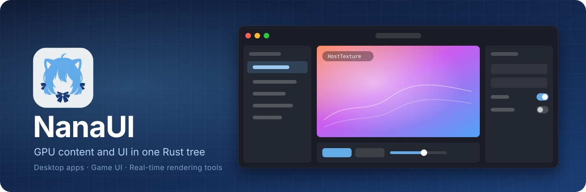
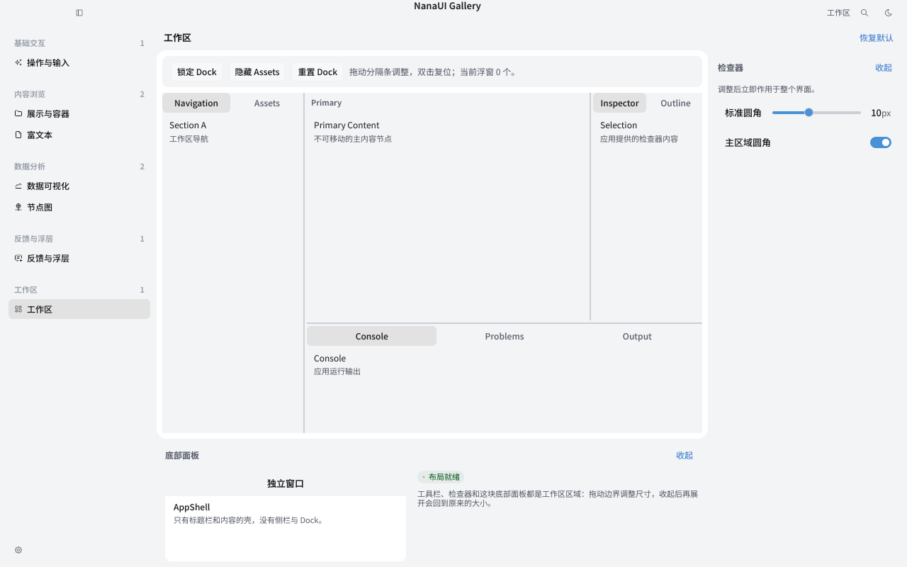
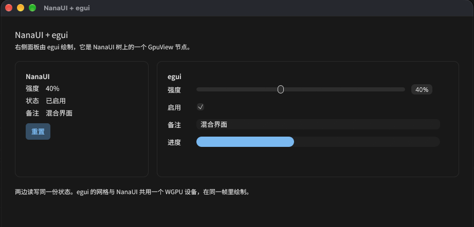
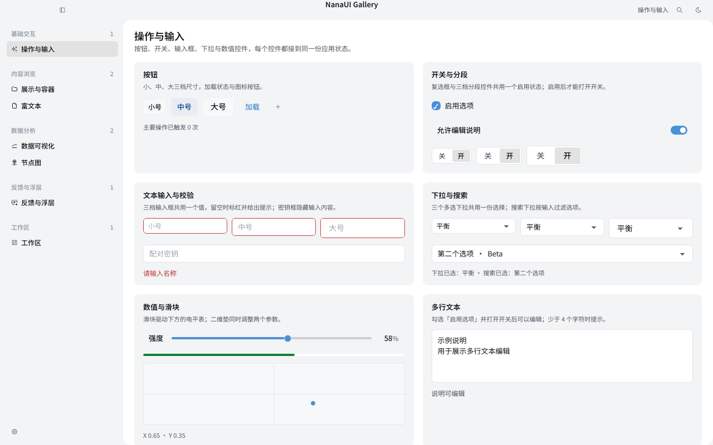
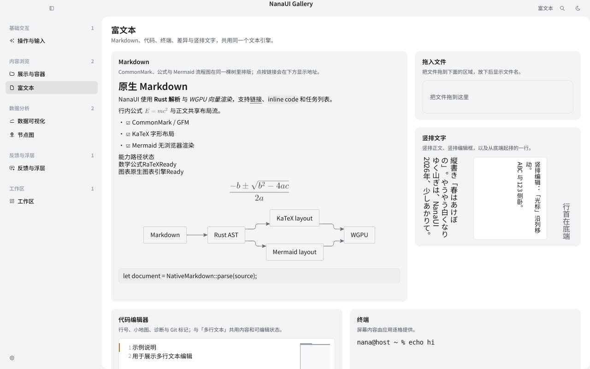
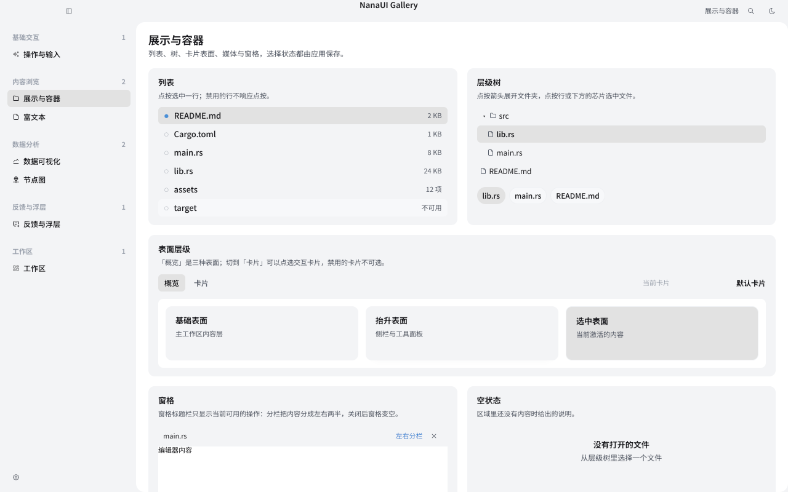
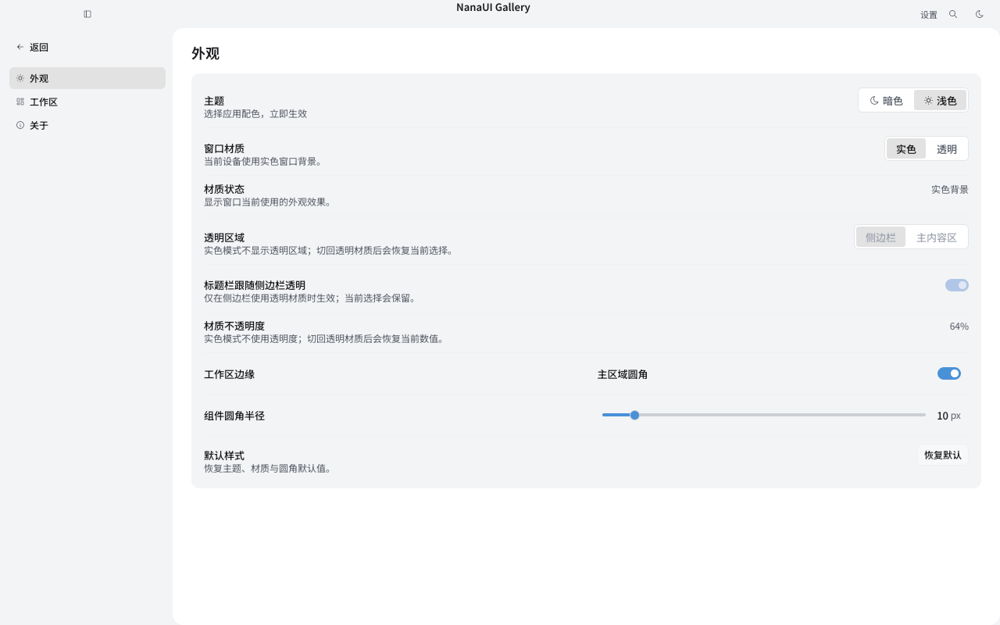
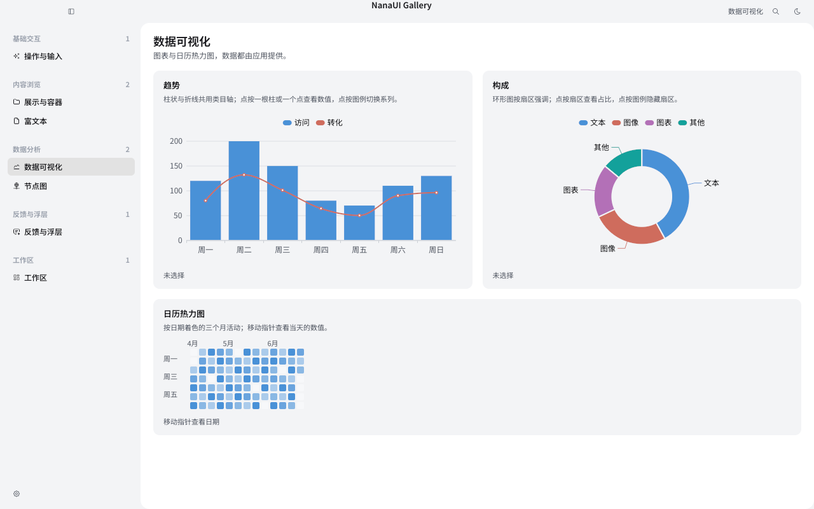

<p align="center">
  
</p>

<p align="center">
  <b>English</b> · <a href="README.zh-CN.md">简体中文</a>
</p>

<p align="center">
  A Rust UI framework where live GPU content is an ordinary node in the UI tree.
</p>

<p align="center">
  
  
</p>

<p align="center">
  <a href="https://sena-nana.github.io/NanaUI/">Documentation</a> ·
  <a href="https://sena-nana.github.io/NanaUI/guide/quick-start">Quick start</a> ·
  <a href="https://sena-nana.github.io/NanaUI/guide/introduction">Guide</a> ·
  <a href="https://sena-nana.github.io/NanaUI/components/">Components</a> ·
  <a href="https://sena-nana.github.io/NanaUI/architecture/">Architecture</a> ·
  <a href="examples">Examples</a>
</p>

<p align="center">
  <picture>
    <source media="(prefers-color-scheme: dark)" srcset="examples/component-gallery/snapshots/metal-apple-m4/gallery-workspace-dark.png">
    
  </picture>
</p>

> [!WARNING]
> NanaUI is in early development. It is not published on crates.io yet, and the API will keep changing.

## Why NanaUI

NanaUI started from one concrete need: mixing live GPU content and a complete UI in the same window. Most approaches we tried forced a choice. Either the UI is in charge, and GPU content can only be a texture or a hole cut into the interface; or rendering is in charge, and the UI is a HUD layered on top, with clipping, hit testing, focus and window behavior left for you to rebuild.

In NanaUI, GPU content is an ordinary node in the UI tree. It takes part in layout, clipping, hit testing and draw order alongside buttons and text. The application owns the WGPU device, and NanaUI draws into the frames the application hands it.

That makes it a fit for editors and creative tools with preview viewports, games that need menus and HUDs, and real-time tools such as shader debuggers and visualizers. In all of these, the live content and the controls share one layout pass, one hit-test structure and one GPU device.

The other reason is that the Rust UI frameworks we looked at each leave gaps: some are immediate mode and struggle with large desktop interfaces; some have immature layout, text shaping or IME support; some rely on an embedded browser; few treat windowing, accessibility, theming, developer tools and packaging as one system. NanaUI aims to be a more complete system in which the framework provides all of these and they work together.

## Design goals

- **One UI tree.** Controls, text and GPU content live in the same retained tree, with one layout engine, one hit-test structure and one text engine.
- **The application owns the GPU.** The window, surface and WGPU device belong to the application. NanaUI never creates a second device and never reads frames back to the CPU.
- **Work proportional to change.** Frames with no changes do no work, and a local edit only recomputes what it affects. Work counters in CI enforce this.
- **Completeness.** Windowing, IME, accessibility, theming, hot reload, debugging and packaging come with the framework instead of being assembled by each application.

NanaUI is not a browser shell, does not offer an immediate-mode API, and is not a game engine. Scenes, physics and asset pipelines stay with your engine or renderer; NanaUI handles the UI and places your content inside it.

## Features

| Area | What you get |
| --- | --- |
| Controls | About 90: forms, lists, tables, trees, dialogs, drawers, toasts, date and color pickers, node graphs, timelines, a rich text editor |
| Desktop shell | Shell, Workspace, Dock, command palette, overlays, multiple windows; Mica / Acrylic / Vibrancy system materials |
| Text | In-house engine: shaping, layout, vertical text, bidirectional text, IME composition, CLDR locale formatting |
| Rich content | Markdown, KaTeX math, Mermaid diagrams and ECharts-style charts, with no browser involved |
| Authoring | Plain Rust functions, the `view!` macro, and `.vue` single-file components whose scripts are Rust |
| Styling | A CSS subset compiled at build time, light and dark themes, custom themes and material shaders |
| Accessibility | An incremental accessibility tree built on AccessKit |
| Tooling | Hot reload, headless snapshot tests, debugging sessions, structured diagnostic logs (`.nlog`) |
| Packaging | Resource packs, content signing, platform directory layouts, Steam output |

## Example

The same counter written three ways. Plain Rust functions are the most common style; the `view!` macro and `.vue` single-file components are template forms that expand to the same function calls and the same UI tree.

<table>
<tr>
<th align="left" valign="top" width="120">Rust</th>
<td>

```rust
fn counter() -> impl IntoView {
    let count = signal(0u64);
    row().gap(8).children((
        text!("Count: {count}"),
        button("Increment").on_activate(move || count.update(|c| *c += 1)),
    ))
}
```

</td>
</tr>
<tr>
<th align="left" valign="top" width="120">Rust · <code>view!</code></th>
<td>

```rust
fn counter() -> impl IntoView {
    let count = signal(0u64);
    view! {
        <Row gap=8>
            <Text>"Count: {count}"</Text>
            <Button @activate={count.update(|c| *c += 1)}>"Increment"</Button>
        </Row>
    }
}
```

</td>
</tr>
<tr>
<th align="left" valign="top" width="120"><code>.vue</code></th>
<td>

```vue
<script setup lang="rust">
let count = signal(0);
</script>

<template>
  <Row :gap="8">
    <Text>Count: {{ count }}</Text>
    <Button @activate="count.update(|c| *c += 1)">Increment</Button>
  </Row>
</template>
```

</td>
</tr>
</table>

For complete runnable programs, see [`application-counter`](crates/nana-ui/examples/application-counter.rs), [`reactive-counter`](crates/nana-ui/examples/reactive-counter.rs) and [`examples/reactive-sfc`](examples/reactive-sfc).

## Mixing with other UI frameworks

Because GPU content is an ordinary node in the tree, whatever another UI framework draws can also become a node in NanaUI. It is laid out, clipped and ordered together with the surrounding NanaUI controls, and shares the same WGPU device and the same submission. An existing egui debug panel or a game's built-in tool UI can move into a NanaUI window without a rewrite, and be migrated piece by piece later.

<p align="center">
  
</p>

[`egui-in-nanaui`](crates/nana-ui/examples/egui-in-nanaui.rs) mounts an egui panel as a `GpuView` node between NanaUI controls, with both sides reading and writing the same state. NanaUI forwards pointer, wheel and text input to egui:

```bash
cargo run -p nana-ui --example egui-in-nanaui --features hosted,bundled-fonts,wgpu-interop
```

## Screenshots

<table>
  <tr>
    <td width="50%" align="center">
      <picture>
        <source media="(prefers-color-scheme: dark)" srcset="examples/component-gallery/snapshots/metal-apple-m4/gallery-controls-dark.png">
        
      </picture>
      <sub>Controls: size tiers, form validation, selection and sliders</sub>
    </td>
    <td width="50%" align="center">
      <picture>
        <source media="(prefers-color-scheme: dark)" srcset="examples/component-gallery/snapshots/metal-apple-m4/gallery-rich-text-dark.png">
        
      </picture>
      <sub>Rich text: vertical writing, Markdown, KaTeX and Mermaid</sub>
    </td>
  </tr>
  <tr>
    <td width="50%" align="center">
      <picture>
        <source media="(prefers-color-scheme: dark)" srcset="examples/component-gallery/snapshots/metal-apple-m4/gallery-surfaces-dark.png">
        
      </picture>
      <sub>Surfaces and split panes</sub>
    </td>
    <td width="50%" align="center">
      <picture>
        <source media="(prefers-color-scheme: dark)" srcset="examples/component-gallery/snapshots/metal-apple-m4/gallery-settings-appearance-dark.png">
        
      </picture>
      <sub>Settings page and appearance switching</sub>
    </td>
  </tr>
  <tr>
    <td colspan="2" align="center">
      <picture>
        <source media="(prefers-color-scheme: dark)" srcset="examples/component-gallery/snapshots/metal-apple-m4/gallery-data-dark.png">
        
      </picture>
      <sub>Data: bar/line combination, donut and calendar heatmap</sub>
    </td>
  </tr>
</table>

<p align="center"><sub>Screenshots are rendered output from the <a href="examples/component-gallery">component-gallery</a> snapshot tests (Metal, Apple M4). They follow your GitHub theme. The gallery UI text is in Chinese.</sub></p>

## Built with NanaUI

<table>
  <tr>
    <td width="50%" valign="top">
      
      <b>NanaType</b><br>
      <sub>A live-streaming typewriter for VTubers: lines you type play out character by character in an AVG / RPG dialogue box and go to OBS via Spout2 / Syphon.</sub><br>
      <a href="https://github.com/sena-nana/NanaType">GitHub</a> ·
      <a href="https://store.steampowered.com/app/5507600">Steam</a>
    </td>
    <td width="50%" valign="top">
      
      <b>NanaLive</b><br>
      <sub>Live2D desktop scenes and stream output for VTubers.</sub><br>
      <sub>In development</sub>
    </td>
  </tr>
</table>

## Getting started

NanaUI requires Rust 1.98 or newer. From the repository root, try the examples first:

```bash
cargo run -p component-gallery
```

```bash
cargo run -p nana-ui --example hosted-gpu-demo --features hosted,bundled-fonts,wgpu-interop
```

The first opens the control and workspace gallery; the second puts the UI and live GPU content in the same window. Then add the dependency to your own project:

```toml
[dependencies]
nana-ui = { git = "https://github.com/sena-nana/NanaUI", features = ["hosted", "bundled-fonts", "view-macro"] }
```

<details>
<summary><b>Common features</b></summary>
<br>

| Feature | Purpose |
| --- | --- |
| `hosted` | Desktop host: windows, event loop, platform accessibility; implies `gpu` |
| `bundled-fonts` | Ships Noto Sans SC as the default UI font (about 4.2 MiB); without it text uses system fonts |
| `view-macro` | The `view!`, `css!` and `stylesheet!` macros |
| `components` | Calendar, charts, node graph, image viewer, rich text and other control families |
| `wgpu-interop` | Access to the WGPU objects behind `GpuContext` |
| `snippet-transforms` | Regular-expression transforms in snippets |
| `svg` | SVG images (icons are drawn from their own geometry and do not need it) |
| `full` | `hosted`, `bundled-fonts`, `components`, `syntax-highlighting`, `icu`, `snippet-transforms`, `svg` |

`wgpu-backends`, `icu`, `snippet-transforms` and `svg` are on by default; an application that sets `default-features = false` names the ones it uses. The full list is in [`nana-ui`](crates/nana-ui).

</details>

Next, read [Quick start](https://sena-nana.github.io/NanaUI/guide/quick-start) and [Creating an application](https://sena-nana.github.io/NanaUI/guide/essentials/application).

## Platform support

| Platform | Status |
| --- | --- |
| Windows 10 / 11 | Supported |
| macOS | Supported |
| Linux | Supported; system materials unavailable |
| Android / iOS | Experimental |
| OpenHarmony | Builds only |

## Performance

| Measurement | Result |
| --- | --- |
| Dispatching a pointer move over a list of 250 to 2 000 rows | 0.3 µs, independent of row count |
| Changing one control's text on a page with 42 001 boxes, full frame | 21 µs |
| Thread stack needed to finish a layout, 64 to 500 levels of nesting | 116 KiB, independent of depth |
| Cold full-page layout, 21 001 boxes, per box (Taffy 0.11: 0.70 µs) | 1.24 µs |

Measured on an Apple M4 with release builds. Cold layout is about 1.8× slower than [Taffy](https://github.com/DioxusLabs/taffy) because NanaUI's layout also maintains the state needed for incremental updates and accessibility; this is still being optimized. Methodology and reproduction commands are in [resource budgets](https://sena-nana.github.io/NanaUI/reference/resource-budgets) and [`perf/`](perf/README.md).

## Project layout

Applications usually depend on `nana-ui` only. See [architecture contracts](https://sena-nana.github.io/NanaUI/reference/architecture) for the overall architecture.

<details>
<summary><b>All crates</b></summary>
<br>

| Crate | Description |
| --- | --- |
| [`nana-ui`](crates/nana-ui) | Facade crate: application entry points, window host, WGPU painting |
| [`nana-ui-runtime`](crates/nana-ui-runtime) | UI tree, components, layout, input, accessibility |
| [`nana-ui-scene`](crates/nana-ui-scene) | GPU-independent drawable scene |
| [`nana-ui-core`](crates/nana-ui-core) | Shared types: style, themes, geometry |
| [`nana-text`](crates/nana-text) | Text engine |
| [`nana-ui-css`](crates/nana-ui-css) | Build-time CSS engine |
| [`nana-ui-sfc`](crates/nana-ui-sfc) | `.vue` single-file component compiler |
| [`nana-ui-view-macros`](crates/nana-ui-view-macros) | The `view!` macro |
| [`nana-ui-view-codegen`](crates/nana-ui-view-codegen) | Template code generation (internal) |
| [`nana-ui-view-schema`](crates/nana-ui-view-schema) | Built-in control table (internal) |
| [`nana-ui-dev`](crates/nana-ui-dev) | Hot reload |
| [`nana-ui-devtools`](crates/nana-ui-devtools) | Headless snapshots and debugging sessions |
| [`nana-gpu`](crates/nana-gpu) | GPU interface layer |
| [`nana-frame-exchange`](crates/nana-frame-exchange) | Passing GPU frames across threads |
| [`nana-window`](crates/nana-window) | Native windows, system materials and title bars |
| [`nana-ui-platform`](crates/nana-ui-platform) | Platform-neutral window, clipboard and path interfaces |
| [`nana-ui-input`](crates/nana-ui-input) | Canonical input events |
| [`nana-diagnostics`](crates/nana-diagnostics) | Structured diagnostics and `.nlog` |
| [`nana-ui-charts`](crates/nana-ui-charts) | Chart model |
| [`nana-ui-diagram`](crates/nana-ui-diagram) | Mermaid diagram engine |
| [`nana-svg-raster`](crates/nana-svg-raster) | SVG rasterization |
| [`nana-icons-tabler`](crates/nana-icons-tabler) | The full Tabler icon set |
| [`nana-app-icon`](crates/nana-app-icon) | App icon encoding and embedding |
| [`nana-package`](crates/nana-package) | Resource pack runtime |
| [`nana-packager`](crates/nana-packager) | Packaging tool |

</details>

## Contributing

Before you start, read [AGENTS.md](AGENTS.md), which describes the framework's boundaries and the rules every change must follow. Before submitting, run:

```bash
cargo fmt --all -- --check
```

```bash
cargo test --workspace
```

## License

NanaUI is dual-licensed under [MIT](LICENSE-MIT) or [Apache-2.0](LICENSE-APACHE), at your option.

Unless you explicitly state otherwise, any contribution intentionally submitted for inclusion in NanaUI by you, as defined in the Apache-2.0 license, shall be dual-licensed as above, without any additional terms or conditions.
