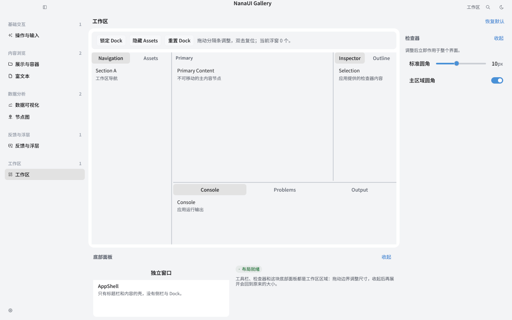
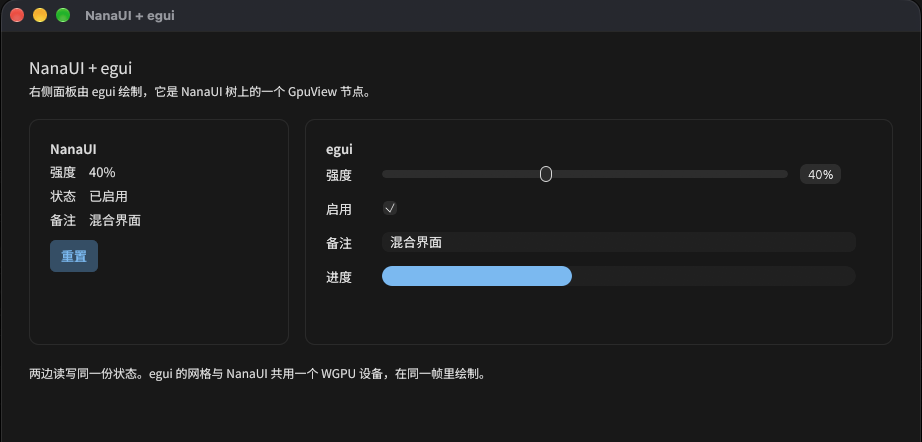
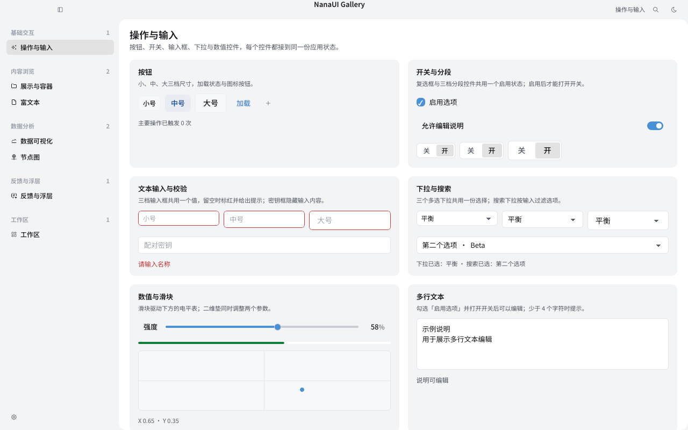
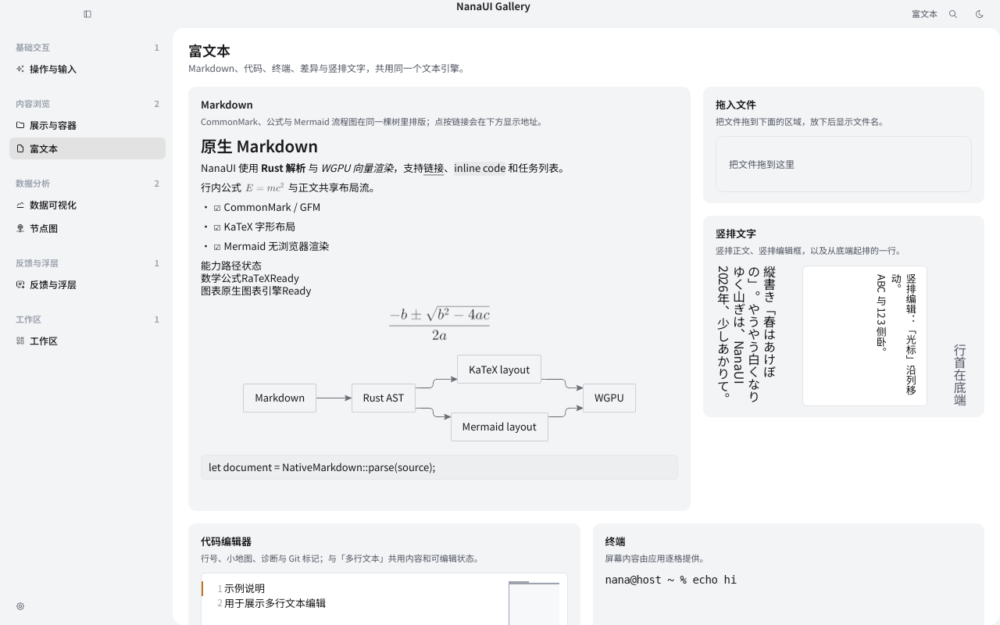
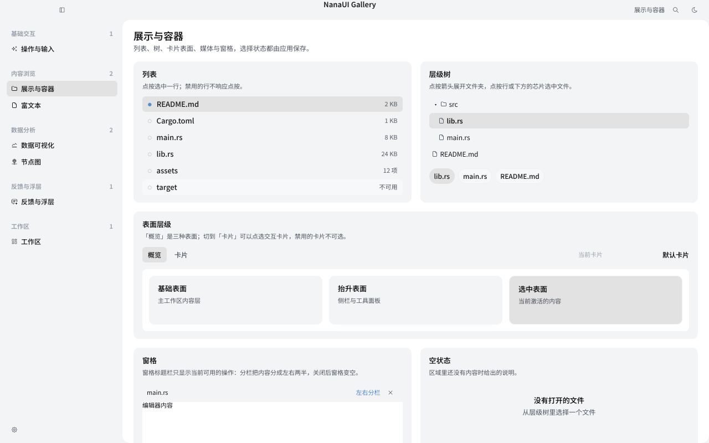
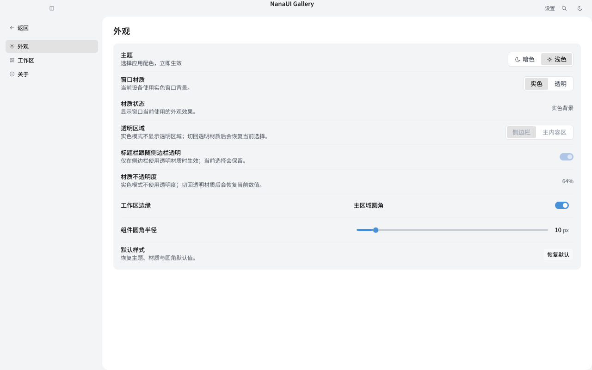
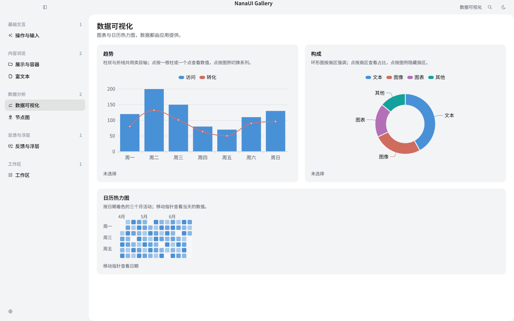

<p align="center">
  
</p>

<p align="center">
  <a href="README.md">English</a> · <b>简体中文</b>
</p>

<p align="center">
  一个把实时 GPU 画面作为普通界面节点的 Rust UI 框架。
</p>

<p align="center">
  
  
</p>

<p align="center">
  <a href="https://sena-nana.github.io/NanaUI/zh/">文档</a> ·
  <a href="https://sena-nana.github.io/NanaUI/zh/guide/quick-start">快速开始</a> ·
  <a href="https://sena-nana.github.io/NanaUI/zh/guide/introduction">指南</a> ·
  <a href="https://sena-nana.github.io/NanaUI/zh/components/">组件</a> ·
  <a href="https://sena-nana.github.io/NanaUI/zh/architecture/">架构</a> ·
  <a href="examples">示例</a>
</p>

<p align="center">
  <picture>
    <source media="(prefers-color-scheme: dark)" srcset="examples/component-gallery/snapshots/metal-apple-m4/gallery-workspace-dark.png">
    
  </picture>
</p>

> [!WARNING]
> NanaUI 仍在早期开发中，还没有发布到 crates.io，API 会持续变化。

## 为什么做 NanaUI

NanaUI 最初是为了一个具体的需求：在同一个窗口里把实时的 GPU 画面和完整的界面混合在一起。我们试过的方案大多只能二选一：要么界面是主角，GPU 画面只能当贴图、或者在界面上挖一个洞；要么渲染是主角，界面是叠在画面上的一层 HUD，裁剪、点击、焦点和窗口行为都得自己补。

在 NanaUI 里，GPU 画面是界面树上的一个普通节点，和按钮、文字一起参与布局、裁剪、点击和绘制顺序。应用自己持有 WGPU 设备，NanaUI 画进应用交给它的帧。

因此它适用于几类程序：带预览视口的编辑器和创作工具、需要菜单与 HUD 的游戏、着色器调试和可视化这类实时渲染工具。在这些场景里，实时画面和控件共用一次布局、一套命中测试和一份 GPU 设备。

另一个原因是，Rust 现有的 UI 框架各有不完整的地方：有的是即时模式，难以承载大型桌面界面；有的布局、文字排版或输入法还不够成熟；有的要靠嵌入浏览器；很少有框架把窗口、无障碍、主题、开发工具和打包放在一起考虑。NanaUI 的目标是一个更完整的系统，这些都由框架统一提供，并且彼此配合。

## 设计目标

- **单一界面树。** 控件、文字和 GPU 内容都在同一棵保留树里，只有一套布局、一套命中测试、一个文字引擎。
- **GPU 归应用所有。** 窗口、Surface 和 WGPU 设备属于应用。NanaUI 不创建第二个 Device，也不把画面读回 CPU。
- **工作量与改动成正比。** 没有变化的帧不做任何工作，局部修改只重算受影响的部分，由 CI 中的工作量计数器检查。
- **完整性。** 窗口、输入法、无障碍、主题、热重载、调试和打包都由框架提供，不需要应用自己拼装。

NanaUI 不是浏览器套壳，不提供即时模式 API，本身也不是游戏引擎：场景、物理和资源管线仍由你的引擎或渲染代码负责，NanaUI 负责界面，并把你的画面放进界面里。

## 功能

| 领域 | 内容 |
| --- | --- |
| 控件 | 约 90 个：表单、列表、表格、树、对话框、抽屉、Toast、日期与颜色选择、节点图、时间线、富文本编辑器 |
| 桌面壳层 | Shell、Workspace、Dock、命令面板、浮层、多窗口；Mica / Acrylic / Vibrancy 系统材质 |
| 文字 | 自研引擎：塑形、排版、竖排、双向文本、IME 组合输入、CLDR 区域格式化 |
| 富内容 | Markdown、KaTeX 公式、Mermaid 图、ECharts 风格图表，不经浏览器 |
| 写法 | Rust builder、`view!` 宏、脚本用 Rust 写的 `.vue` 单文件组件 |
| 样式 | 构建期编译的 CSS 子集，亮色与暗色主题，自定义主题与材质着色器 |
| 无障碍 | 基于 AccessKit 的增量无障碍树 |
| 工具 | 热重载、无头快照测试、调试会话、结构化诊断日志（`.nlog`） |
| 打包 | 资源包、内容签名、平台目录布局、Steam 输出 |

## 示例

同一个计数器的三种写法。最常用的是直接调用 Rust 函数；`view!` 宏和 `.vue` 单文件组件只是模板形式，展开后得到同样的函数调用和同一棵界面树。

<table>
<tr>
<th align="left" valign="top" width="120">Rust 函数</th>
<td>

```rust
fn counter() -> impl IntoView {
    let count = signal(0u64);
    row().gap(8).children((
        text!("计数 {count}"),
        button("增加").on_activate(move || count.update(|c| *c += 1)),
    ))
}
```

</td>
</tr>
<tr>
<th align="left" valign="top" width="120">Rust · <code>view!</code></th>
<td>

```rust
fn counter() -> impl IntoView {
    let count = signal(0u64);
    view! {
        <Row gap=8>
            <Text>"计数 {count}"</Text>
            <Button @activate={count.update(|c| *c += 1)}>"增加"</Button>
        </Row>
    }
}
```

</td>
</tr>
<tr>
<th align="left" valign="top" width="120"><code>.vue</code></th>
<td>

```vue
<script setup lang="rust">
let count = signal(0);
</script>

<template>
  <Row :gap="8">
    <Text>计数 {{ count }}</Text>
    <Button @activate="count.update(|c| *c += 1)">增加</Button>
  </Row>
</template>
```

</td>
</tr>
</table>

完整可运行的程序见 [`application-counter`](crates/nana-ui/examples/application-counter.rs)、[`reactive-counter`](crates/nana-ui/examples/reactive-counter.rs) 和 [`examples/reactive-sfc`](examples/reactive-sfc)。

## 与其他 UI 框架混合

因为 GPU 内容是树上的普通节点，另一个 UI 框架画出来的东西也可以作为节点放进 NanaUI：它和周围的 NanaUI 控件一起布局、裁剪和排序，共用同一个 WGPU 设备和同一次提交。已有的 egui 调试面板、游戏里现成的工具界面，不需要重写就能搬进 NanaUI 的窗口，再逐步迁移。

<p align="center">
  
</p>

[`egui-in-nanaui`](crates/nana-ui/examples/egui-in-nanaui.rs) 把一个 egui 面板挂成 `GpuView` 节点，上下都是 NanaUI 控件，两边读写同一份状态。egui 的指针、滚轮和文字输入由 NanaUI 转交：

```bash
cargo run -p nana-ui --example egui-in-nanaui --features hosted,bundled-fonts,wgpu-interop
```

## 截图

<table>
  <tr>
    <td width="50%" align="center">
      <picture>
        <source media="(prefers-color-scheme: dark)" srcset="examples/component-gallery/snapshots/metal-apple-m4/gallery-controls-dark.png">
        
      </picture>
      <sub>控件：尺寸档位、表单校验、选择与滑块</sub>
    </td>
    <td width="50%" align="center">
      <picture>
        <source media="(prefers-color-scheme: dark)" srcset="examples/component-gallery/snapshots/metal-apple-m4/gallery-rich-text-dark.png">
        
      </picture>
      <sub>富文本：竖排、Markdown、KaTeX 与 Mermaid</sub>
    </td>
  </tr>
  <tr>
    <td width="50%" align="center">
      <picture>
        <source media="(prefers-color-scheme: dark)" srcset="examples/component-gallery/snapshots/metal-apple-m4/gallery-surfaces-dark.png">
        
      </picture>
      <sub>表面与分栏</sub>
    </td>
    <td width="50%" align="center">
      <picture>
        <source media="(prefers-color-scheme: dark)" srcset="examples/component-gallery/snapshots/metal-apple-m4/gallery-settings-appearance-dark.png">
        
      </picture>
      <sub>设置页与外观切换</sub>
    </td>
  </tr>
  <tr>
    <td colspan="2" align="center">
      <picture>
        <source media="(prefers-color-scheme: dark)" srcset="examples/component-gallery/snapshots/metal-apple-m4/gallery-data-dark.png">
        
      </picture>
      <sub>数据：柱线组合图、环形图与日历热力图</sub>
    </td>
  </tr>
</table>

<p align="center"><sub>截图为 <a href="examples/component-gallery">component-gallery</a> 快照测试的渲染输出（Metal，Apple M4），随 GitHub 主题显示亮色或暗色版本。</sub></p>

## 使用 NanaUI 的应用

<table>
  <tr>
    <td width="50%" valign="top">
      
      <b>NanaType</b><br>
      <sub>虚拟主播直播打字机：把打下的台词逐字演成 AVG / RPG 对话框，经 Spout2 / Syphon 送进 OBS。</sub><br>
      <a href="https://github.com/sena-nana/NanaType">GitHub</a> ·
      <a href="https://store.steampowered.com/app/5507600">Steam</a>
    </td>
    <td width="50%" valign="top">
      
      <b>NanaLive</b><br>
      <sub>面向虚拟主播的 Live2D 桌面场景与直播输出软件。</sub><br>
      <sub>开发中</sub>
    </td>
  </tr>
</table>

## 开始使用

需要 Rust 1.98 或更新版本。先在仓库根目录跑一下示例：

```bash
cargo run -p component-gallery
```

```bash
cargo run -p nana-ui --example hosted-gpu-demo --features hosted,bundled-fonts,wgpu-interop
```

第一条是控件与工作区目录，第二条把界面和实时 GPU 画面放在同一个窗口里。然后在自己的项目中加上依赖：

```toml
[dependencies]
nana-ui = { git = "https://github.com/sena-nana/NanaUI", features = ["hosted", "bundled-fonts", "view-macro"] }
```

<details>
<summary><b>常用 feature</b></summary>
<br>

| Feature | 作用 |
| --- | --- |
| `hosted` | 桌面宿主：窗口、事件循环、平台无障碍，隐含 `gpu` |
| `bundled-fonts` | 内置 Noto Sans SC 作为默认字体 |
| `view-macro` | `view!`、`css!`、`stylesheet!` 宏 |
| `components` | 日历、图表、节点图、图片查看器、富文本等控件族 |
| `wgpu-interop` | 访问 `GpuContext` 背后的 WGPU 对象 |
| `full` | `hosted`、`bundled-fonts`、`components`、`syntax-highlighting`、`icu` |

默认开启 `wgpu-backends` 和 `icu`。完整列表见 [`nana-ui`](crates/nana-ui)。

</details>

接下来读 [快速开始](https://sena-nana.github.io/NanaUI/zh/guide/quick-start) 和 [创建应用](https://sena-nana.github.io/NanaUI/zh/guide/essentials/application)。

## 平台支持

| 平台 | 状态 |
| --- | --- |
| Windows 10 / 11 | 支持 |
| macOS | 支持 |
| Linux | 支持，系统材质不可用 |
| Android / iOS | 实验性 |
| OpenHarmony | 仅保证编译 |

## 性能

| 测量 | 结果 |
| --- | --- |
| 指针移动的派发，250 到 2 000 行的列表 | 0.3 µs，与行数无关 |
| 42 001 个盒子的页面上修改一个控件的文字，整帧 | 21 µs |
| 完成一次布局所需的线程栈，嵌套 64 到 500 层 | 116 KiB，与深度无关 |
| 冷启动整页布局，21 001 个盒子，每盒（Taffy 0.11 为 0.70 µs） | 1.24 µs |

数据来自 Apple M4，release 构建。冷启动布局比 [Taffy](https://github.com/DioxusLabs/taffy) 慢约 1.8 倍，差距来自 NanaUI 布局时还要维护增量更新与无障碍所需的状态，仍在优化。测量方法与复现命令见 [资源预算](https://sena-nana.github.io/NanaUI/zh/reference/resource-budgets) 和 [`perf/`](perf/README.md)。

## 项目结构

应用通常只依赖 `nana-ui`。整体架构见 [架构合同](https://sena-nana.github.io/NanaUI/zh/reference/architecture)。

<details>
<summary><b>全部 crate</b></summary>
<br>

| Crate | 说明 |
| --- | --- |
| [`nana-ui`](crates/nana-ui) | 门面 crate：应用入口、窗口宿主、WGPU 绘制 |
| [`nana-ui-runtime`](crates/nana-ui-runtime) | 界面树、组件、布局、输入、无障碍 |
| [`nana-ui-scene`](crates/nana-ui-scene) | 与 GPU 无关的绘制场景 |
| [`nana-ui-core`](crates/nana-ui-core) | 样式、主题、几何等共享类型 |
| [`nana-text`](crates/nana-text) | 文字引擎 |
| [`nana-ui-css`](crates/nana-ui-css) | 构建期 CSS 引擎 |
| [`nana-ui-sfc`](crates/nana-ui-sfc) | `.vue` 单文件组件编译器 |
| [`nana-ui-view-macros`](crates/nana-ui-view-macros) | `view!` 宏 |
| [`nana-ui-view-codegen`](crates/nana-ui-view-codegen) | 模板代码生成（内部） |
| [`nana-ui-view-schema`](crates/nana-ui-view-schema) | 内置控件表（内部） |
| [`nana-ui-dev`](crates/nana-ui-dev) | 热重载 |
| [`nana-ui-devtools`](crates/nana-ui-devtools) | 无头快照与调试会话 |
| [`nana-gpu`](crates/nana-gpu) | GPU 接口层 |
| [`nana-frame-exchange`](crates/nana-frame-exchange) | 跨线程交换 GPU 帧 |
| [`nana-window`](crates/nana-window) | 原生窗口、系统材质与标题栏 |
| [`nana-ui-platform`](crates/nana-ui-platform) | 平台无关的窗口、剪贴板与路径接口 |
| [`nana-ui-input`](crates/nana-ui-input) | 规范输入事件 |
| [`nana-diagnostics`](crates/nana-diagnostics) | 结构化诊断与 `.nlog` |
| [`nana-ui-charts`](crates/nana-ui-charts) | 图表模型 |
| [`nana-ui-diagram`](crates/nana-ui-diagram) | Mermaid 图引擎 |
| [`nana-svg-raster`](crates/nana-svg-raster) | SVG 光栅化 |
| [`nana-icons-tabler`](crates/nana-icons-tabler) | Tabler 图标全集 |
| [`nana-app-icon`](crates/nana-app-icon) | 应用图标编码与嵌入 |
| [`nana-package`](crates/nana-package) | 资源包运行时 |
| [`nana-packager`](crates/nana-packager) | 打包工具 |

</details>

## 参与开发

动手之前请先读 [AGENTS.md](AGENTS.md)，里面写了框架的边界和必须遵守的约定。提交前运行：

```bash
cargo fmt --all -- --check
```

```bash
cargo test --workspace
```

## 许可

NanaUI 以 [MIT](LICENSE-MIT) 或 [Apache-2.0](LICENSE-APACHE) 双许可发布，由你任选其一。

除非你另有明确声明，你按 Apache-2.0 许可的定义有意提交给 NanaUI 的任何贡献，都将按上述双许可发布，不附加任何其他条款或条件。
